# Stratagem Hero · HDWearStrategy

[](https://www.google.com/search?q=Wear+OS)
[](https://developer.android.com)
[](dist/)
[](LICENSE)

**中文** · [English](#english)

> 非官方粉丝作品，免费、无广告。  
> HELLDIVERS 2 及其图标、名称、指令、语音与音效版权归 Arrowhead Game Studios / Sony Interactive Entertainment 所有。

---

## 下载 · Downloads

| 版本 | 包名 | 大小 |
|---|---|---|
| 🇨🇳 中文 | `com.deepsea.stratagemhero` | 2,574,107 B |
| 🇬🇧 English | `com.deepsea.stratagemhero.en` | 2,574,107 B |

- 中文：[StratagemHero-Watch4-v1.6.0-zh.apk](dist/StratagemHero-Watch4-v1.6.0-zh.apk)  
  `SHA-256 7446a5e2e6642988eb274879926cc732d6fb97da2d3c7a19330692841fd59963`
- English：[StratagemHero-Watch4-v1.6.0-en.apk](dist/StratagemHero-Watch4-v1.6.0-en.apk)  
  `SHA-256 27c876210d723f755f9c63eec7ee523821c6aa989325e5bdb6245ad35f419f51`
- 键盘服务端（Windows + Linux）：[stratagem-server-v1.0.0.zip](server/dist/stratagem-server-v1.0.0.zip)  
  `SHA-256 07a62628dc075571bfa6de7e52dd992100ed8acb52a613971650eea4a3612600`

两个 APK 使用不同包名，可同时安装。版本 `1.6.0` / `versionCode 8`。

---

## 功能 · Features

- **标准演练**：每组 5 个随机战备，顶部组进度条，组末结算；组号越大进度条越快。
- **自由呼叫**：纯空白、不计时、无分数/连击；匹配指令后播放游戏语音与战备球音效。
- **键盘模式**：局域网配对码连接 PC，箭头和 CTRL 直接映射为键盘。
- **圆屏 / 方屏**：圆屏保留仪表环；方屏使用全屏圆角面板与四边按键。
- **中英双语两版**：独立包名，可同时安装。
- **游戏原声**：输入、确认、失败、开始、组完成/失败、Stratagem Hero BGM，以及分类 Mission Control 语音。

---

## 界面 · Screenshots

### 圆屏 · Round

| 主菜单 | 标准组进度 | 组结算 |
|---|---|---|
| 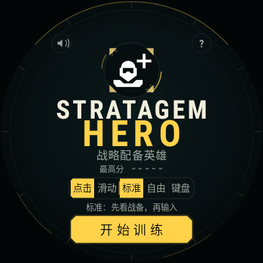 | 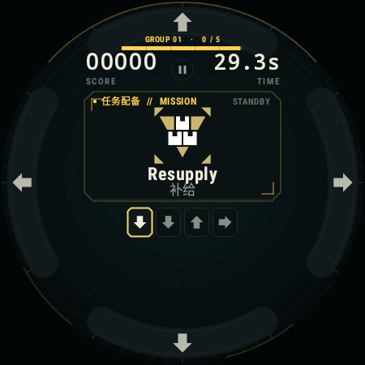 | 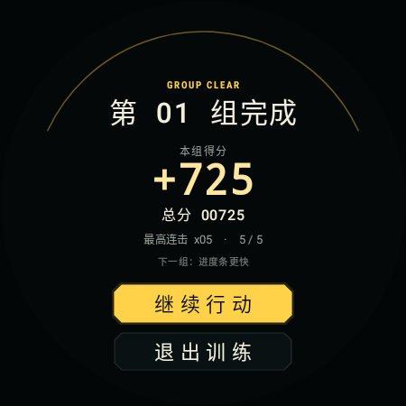 |

| 自由空白 | 输入残影 | 自由揭晓 |
|---|---|---|
| 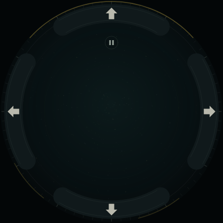 | 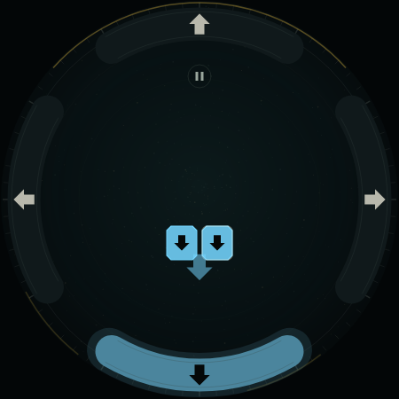 | 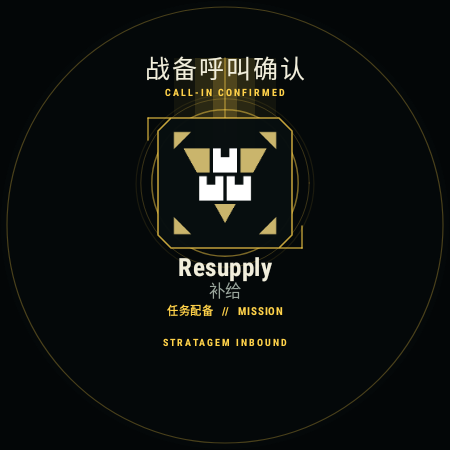 |

### 方屏 · Square

| 450 方屏菜单 | 450 方屏游戏 | 396 方屏菜单 |
|---|---|---|
|  | 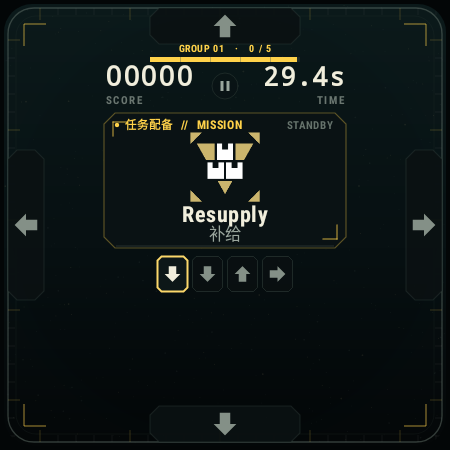 | 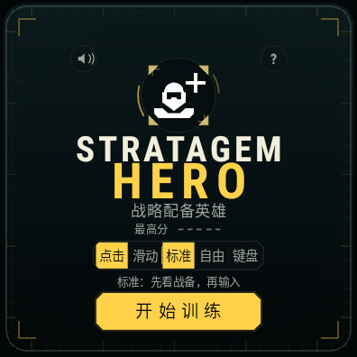 |

### English

| Menu | Game | Field Manual | Keyboard |
|---|---|---|---|
| 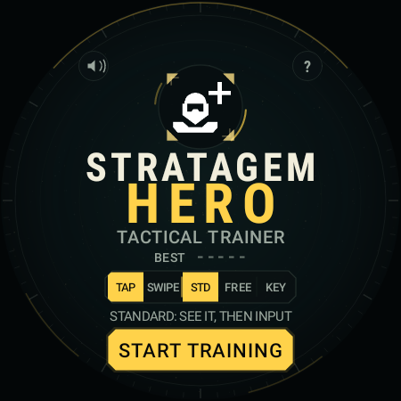 | 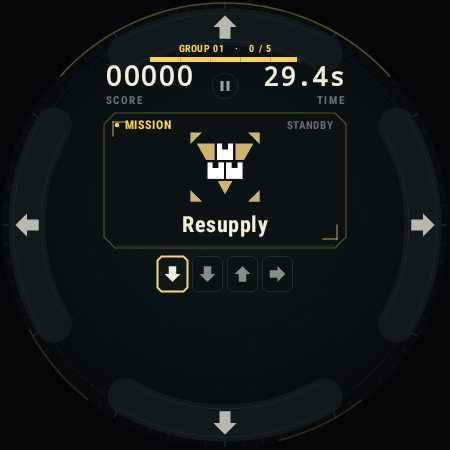 | 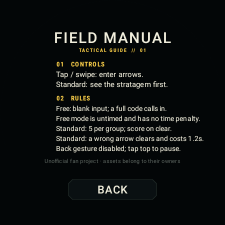 | 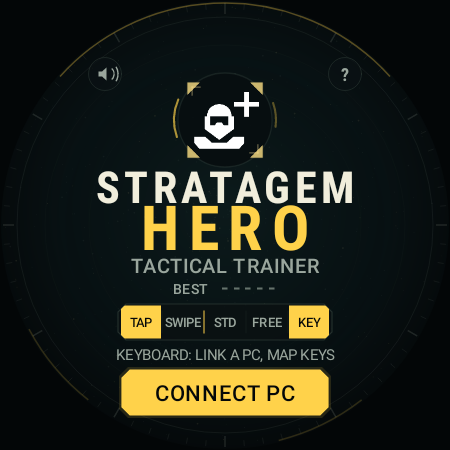 |

### 键盘模式实机 · Keyboard on device

| 配对码 | 已连接 | CTRL 锁定 |
|---|---|---|
| 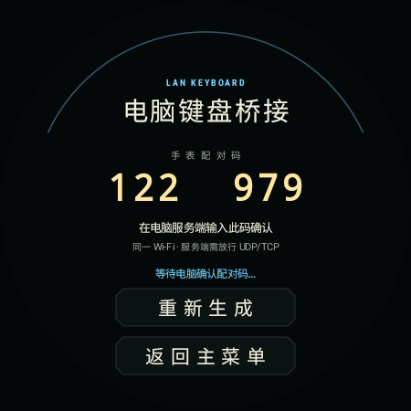 | 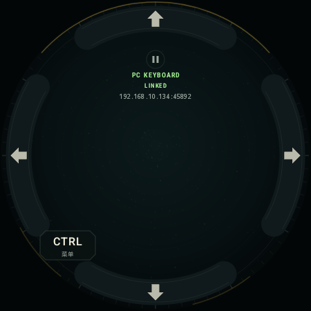 | 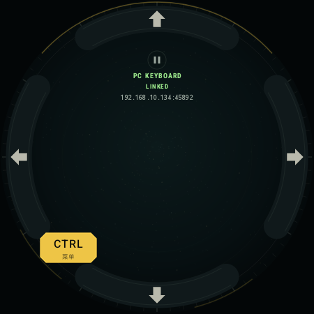 |

键盘暂停 / 重新配对：[v150_remote_pause.png](preview/device/v150_remote_pause.png)

---

## 玩法 · Gameplay

### 标准演练
- 5 个一组，第一组第一个固定补给；顶部进度条 30s → 28s → 26s … 最低 14s。
- 组末结算：本组得分、总分、最高连击；继续/退出。
- 错一个方向清空并扣 1.2 秒；时间耗尽结束。标准模式播放 BGM。

### 自由呼叫
- 不显示分数、连击、呼叫次数、标题或空输入线；只留暂停和按键。
- 不计时、无倒计时、输错不扣时；揭晓无分数，内部也不计分。

### 键盘模式
- 主菜单 → **键盘** → **连接电脑**；手表显示 6 位配对码。
- PC 服务端输入该码；连接后显示 LINKED。
- 方向 → W/S/A/D（可配置）；左下角 **CTRL** 点一下按下、再点一下抬起。
- 暂停/退出/断线自动释放 Ctrl；暂停菜单可继续、重新配对、退出。

### 输入反馈
- 半透明方向残影约 14px / 0.45s 淡出。
- 圆屏点击用外圈弧键；方屏点击用四边条键；滑动模式不显示假按钮。
- 左右阈值约 16px，垂直约 24px，系统取消触摸时按位移补偿。

---

## 键盘服务端 · Keyboard Server

[服务端说明](server/README.md)

- Windows：`stratagem-server-windows-amd64.exe`
- Linux：`stratagem-server-linux-amd64`（uinput，需要 root/udev 权限）
- 默认 `Up=W`, `Down=S`, `Left=A`, `Right=D`, `Menu=LEFTCTRL`
- 配置 `server-config.json`，或命令行 `--up/--down/--left/--right/--menu`
- UDP 45891 配对，TCP 45892 控制；同一 Wi-Fi/网段；Windows 需放行防火墙
- `--dry-run` 只测试网络/映射；`--auto-pair` 跳过手动确认

---

## 安装 · Install

```bash
adb install -r dist/StratagemHero-Watch4-v1.6.0-zh.apk
adb install -r dist/StratagemHero-Watch4-v1.6.0-en.apk
```

```bash
adb shell am start -n com.deepsea.stratagemhero/com.deepsea.stratagemhero.MainActivity
adb shell am start -n com.deepsea.stratagemhero.en/com.deepsea.stratagemhero.MainActivity
```

---

## 构建与测试 · Build & Test

需要 Android SDK 34、Build-Tools 34.0.0、JDK 17。

```bash
./build.sh both     # 中文 + English
./build.sh zh
./build.sh en
./server/build-server.sh
```

- 纯逻辑测试：`# PASS: 710 checks`
- Robolectric：450 圆屏、396 圆屏、450 方屏、396 方屏、英文 UI、五段菜单。
- 实机 v1.5.0（SM-R890 / Android 14）：配对码、LINKED、CTRL 按下/抬起、方向 → D / ↓ → S、服务端 dry-run 已验证。
- v1.6.0 双语/方屏包已完成构建与渲染回归；实机在 v1.5.0 测试后离线，未覆盖安装 v1.6.0。
- 服务端 Windows/Linux 已交叉编译；实际注入需要 Windows 前台/管理员或 Linux `/dev/uinput` 权限。

---

## 素材与声明 · Credits

- 图标：[igromanru/Helldivers-2-Stratagems-icons-png](https://github.com/igromanru/Helldivers-2-Stratagems-icons-png)
- 名称/指令：[Helldivers Wiki](https://helldivers.wiki.gg/wiki/Stratagems)
- 音频/语音：[aido727/HD2-buttons-soundboard-app](https://github.com/aido727/HD2-buttons-soundboard-app)、[BubbleDuckyBro/helldivers-2-stratagem-hero-audio-files](https://github.com/BubbleDuckyBro/helldivers-2-stratagem-hero-audio-files)
- 代码 MIT（见 [LICENSE](LICENSE)）；游戏素材/音频不适用 MIT。
- 与 Arrowhead Game Studios、Sony Interactive Entertainment、Samsung 无关联。

---

# English

**English** · [中文](#stratagem-hero--hdwearstrategy)

A fan-made **Stratagem Hero** for **Samsung Galaxy Watch4** and other Wear OS watches: round and square layouts, Chinese/English builds, and a LAN keyboard bridge for the PC version of HELLDIVERS 2.

> Unofficial fan project. HELLDIVERS 2 and all game assets, names, codes, voices and sounds belong to Arrowhead Game Studios / Sony Interactive Entertainment.

## Downloads

| Build | Package | Size |
|---|---|---|
| 🇨🇳 Chinese | `com.deepsea.stratagemhero` | 2,574,107 B |
| 🇬🇧 English | `com.deepsea.stratagemhero.en` | 2,574,107 B |

- [Chinese APK](dist/StratagemHero-Watch4-v1.6.0-zh.apk)
- [English APK](dist/StratagemHero-Watch4-v1.6.0-en.apk)
- [Keyboard server: Windows + Linux](server/dist/stratagem-server-v1.0.0.zip)

The two APKs use different package IDs and can be installed side by side.

## Features

- **Standard**: 5 random stratagems per group, top group timer, settlement after each group; faster bars at higher group indexes.
- **Free call**: truly blank, untimed, no score/combo; match a full code to hear the call-in voice and reveal the stratagem.
- **Keyboard**: pair over LAN and map watch arrows to PC keys; bottom-left CTRL holds/releases the in-game stratagem menu.
- **Round + square**: circular instrument layout on round screens; full rounded panel and edge keys on square screens.
- **Bilingual builds**: separate Chinese and English packages.
- **Original game audio**: input/confirm/error cues, Stratagem Hero round cues and BGM, beacon and category-grouped Mission Control voice lines.

## Controls

| Action | Default |
|---|---|
| Up | W |
| Down | S |
| Left | A |
| Right | D |
| Stratagem menu | Left Ctrl |

Standard: a wrong arrow clears the code and costs 1.2s. Free: no timer, no score. Keyboard: tap CTRL to hold/release the menu key; pause/exit/disconnect auto-releases it.

## Keyboard server

See [server/README.md](server/README.md).

```bash
sudo ./stratagem-server-linux-amd64     # Linux: uinput needs root/udev
.\stratagem-server-windows-amd64.exe    # Windows
```

Watch: **Keyboard → Connect PC** → enter the 6-digit code shown on the watch into the server console.

## Build & test

```bash
./build.sh both
./server/build-server.sh
```

- **710** pure-logic checks.
- Robolectric renders 450/396 round, 450/396 square, English UI, and the five-mode menu.
- v1.5.0 was tested on a real SM-R890 (pairing, LINKED, CTRL down/up, D/S mapping, server dry-run). v1.6.0 bilingual/square builds passed rendering and build checks; the watch went offline before v1.6.0 could be sideloaded.
- The server binaries are cross-compiled; real key injection needs Windows foreground/admin rights or Linux `/dev/uinput` permissions.

## Credits

Original icons, names, codes and audio belong to Arrowhead Game Studios / Sony Interactive Entertainment. This is a non-commercial fan project, not affiliated with Arrowhead, Sony or Samsung. Code is MIT-licensed; game assets are not.
